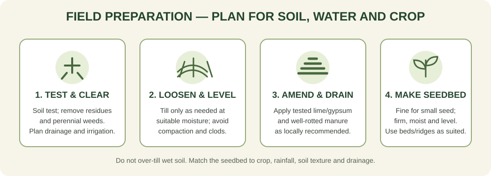
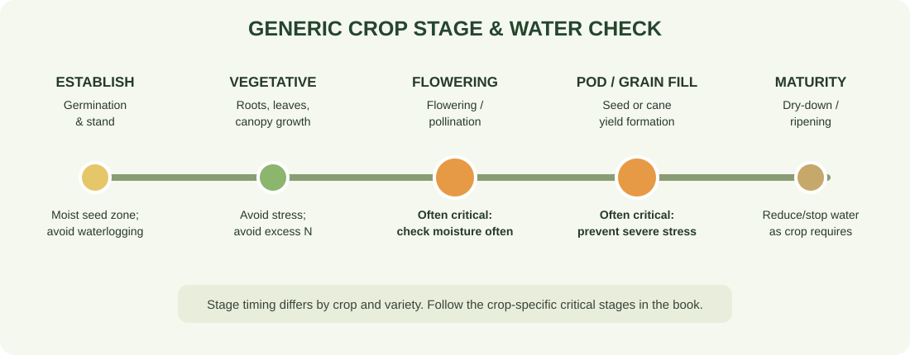

# Crop Package of Practices — India

**English reference edition · 20 November 2026**

**Interactive crop-practices website:** [Open practices.html](./practices.html)

## How to use this book

This is an all-India field reference because no state or agro-climatic zone was
specified. India’s monsoon onset, temperature, soil, crop duration, irrigation access,
and locally released varieties differ widely. The month ranges below are **indicative
seasonal windows**, not a universal sowing calendar. Local SAU/KVK recommendations and
a current soil test take precedence.

## Crop identity, origins and India production snapshot

| Crop | Scientific name | Origin (broad, sometimes debated) | India production, 2025–26 3rd AE |
|---|---|---|---:|
| Groundnut | *Arachis hypogaea* L. | South America, broadly the Bolivia–Paraguay region | 13.074 Mt |
| Indian mustard | *Brassica juncea* (L.) Czern. | Central Asian ancestry; species origin is complex | 13.768 Mt (rapeseed & mustard group) |
| Sunflower | *Helianthus annuus* L. | North America | 0.270 Mt |
| Safflower | *Carthamus tinctorius* L. | Fertile Crescent/eastern Mediterranean; origin debated | 0.066 Mt |
| Niger | *Guizotia abyssinica* (L.f.) Cass. | Ethiopian highlands / northeast Africa | 0.032 Mt |
| Soybean | *Glycine max* (L.) Merr. | East Asia, especially China | 12.596 Mt |
| Sesame | *Sesamum indicum* L. | Origin debated; African ancestry and early South Asian domestication are proposed | Crop figure not transcribed separately |
| Rice / paddy | *Oryza sativa* L. | Asia; domestication history has multiple proposed centres | 154.024 Mt |
| Sugarcane | *Saccharum* spp. hybrid | New Guinea (cultivated-cane ancestry) | See full commercial-crops estimate |
| Cotton | *Gossypium* spp.; chiefly *G. hirsutum* in India | Species-specific: Mesoamerica, Africa and the Indian subcontinent | See full commercial-crops estimate |
| Jute | *Corchorus capsularis* L. / *C. olitorius* L. | South Asia / tropical Africa, respectively | See full commercial-crops estimate |
| Maize | *Zea mays* L. | Mexico | 55.093 Mt |
| Sorghum / jowar | *Sorghum bicolor* (L.) Moench | Northeast Africa, especially Sudan–Ethiopia | 4.356 Mt |
| Pearl millet / bajra | *Cenchrus americanus* (L.) Morrone | West African Sahel | 9.476 Mt |
| Finger millet / ragi | *Eleusine coracana* (L.) Gaertn. | East African highlands | 1.372 Mt |
| Small millets | Multiple species, e.g. *Setaria italica*, *Panicum sumatrense*, *Paspalum scrobiculatum* | Multiple domestication histories across Asia and Africa | See small-millet group |
| Chickpea / gram | *Cicer arietinum* L. | Fertile Crescent / Southwest Asia | Included in total pulses |
| Pigeonpea / tur | *Cajanus cajan* (L.) Millsp. | Indian subcontinent | Included in total pulses |
| Lentil / masoor | *Lens culinaris* Medik. | Fertile Crescent / Southwest Asia | Included in total pulses |
| Mungbean / green gram | *Vigna radiata* (L.) R.Wilczek | Indian subcontinent | Included in total pulses |
| Urdbean / black gram | *Vigna mungo* (L.) Hepper | Indian subcontinent | Included in total pulses |
| Cowpea | *Vigna unguiculata* (L.) Walp. | Africa | Forage production not tabulated in this estimate |
| Berseem | *Trifolium alexandrinum* L. | Eastern Mediterranean / Southwest Asia | Forage production not tabulated in this estimate |
| Fodder oats | *Avena sativa* L. | Fertile Crescent / Southwest Asia | Forage production not tabulated in this estimate |
| Lucerne / alfalfa | *Medicago sativa* L. | Central Asia / Southwest Asia | Forage production not tabulated in this estimate |

Production figures are million tonnes (Mt) converted from lakh tonnes in the official
**Third Advance Estimates for 2025–26**, dated 27 May 2026. They are provisional
production estimates, not yields. Crops described as “included in total pulses” are
not represented as species-specific production. Yield ranges in the crop-practice
tables below are indicative managed-field ranges, **not all-India productivity
statistics**. The supplied estimate does not include the harvested area/yield needed
to calculate national productivity. See the [Directorate of Economics and Statistics
Agricultural Statistics at a Glance](https://desagri.gov.in/document-report-category/agriculture-statistics-at-a-glance/)
for separate area, production and yield series.

Nutrient rates are **kg/ha of N–P₂O₅–K₂O**, not urea/DAP/MOP product weight. They are
broad planning ranges only; use the local soil-test recommendation for a field. Water
figures are approximate crop evapotranspiration **mm/day** during active growth. Actual
water use changes with weather, canopy, crop stage and humidity; irrigation depth must
also account for rainfall, soil storage, and application efficiency. Paddy seepage and
percolation are additional to ETc.

**Units:** 1 ha = 10,000 m²; 1 mm water = 1 L/m² = 10 m³/ha. “Yield” means a broad
well-managed yield range, not a promise. Oilseeds yield is seed (groundnut is pods);
cotton yield is seed cotton; jute yield is dry fibre; forage is identified as fresh or
dry matter where possible.

## Common field-to-harvest rules

1. **Test before treating:** sample the field by management zone; test pH, EC, organic
   carbon, available N/P/K and locally relevant S, Zn, B or other micronutrients.
2. **Prepare the field at workable moisture:** remove or suppress perennial weeds,
   avoid pulverizing dry soil or tilling wet soil, and maintain drainage. Apply lime,
   gypsum or manure only when indicated and at local rates.
3. **Choose the establishment method to fit the field:** line sowing or a calibrated
   planter improves spacing and interculture; transplant rice only where appropriate;
   use beds/ridges for crops and soils needing drainage.
4. **Protect the establishment window:** sow into moist soil at the recommended depth;
   use tested, locally recommended seed and seed treatment; fill gaps early.
5. **Keep the crop weed-free during its early critical period:** normally the first
   3–8 weeks after emergence, but crop-specific windows are given below.
6. **Schedule irrigation from soil moisture and crop stage—not a fixed daily quota.**
   Prioritize establishment, flowering/pollination and yield formation. Avoid
   waterlogging, especially in pulses and most oilseeds.
7. **Split mobile nutrients:** place basal fertilizer near (not touching) seed; split
   N according to crop growth, soil, rainfall and local advice. Do not top-dress onto
   dry soil or immediately before runoff-producing rain.
8. **Harvest at the right maturity:** inspect representative plants and field areas;
   harvest early enough to limit shattering, lodging, fibre loss, sprouting or quality
   decline. Dry and store produce safely.

## Indicative India seasonal calendar

| Season / typical window | Common crops in this book | Field cue |
|---|---|---|
| Kharif, usually June–July sowing (some areas May–August) | Rice, groundnut, soybean, sesame, cotton, maize, sorghum, pearl millet, pigeonpea, mung/urd, kharif fodders | Sow after effective local monsoon onset when seed-zone moisture is adequate; do not sow merely by date. |
| Rabi, usually October–December sowing | Mustard, safflower, chickpea, lentil, rabi sorghum, oats, berseem, some maize/sunflower | Sow after monsoon withdrawal and on residual moisture or with assured irrigation. |
| Summer / zaid, usually February–April sowing | Summer mung/urd, sesame, sunflower, maize, fodder crops, some groundnut | Requires assured irrigation and heat-tolerant varieties; avoid late sowing into extreme heat. |
| Perennial / staggered | Sugarcane; lucerne; irrigated fodder rotations | Planting window depends strongly on region, water availability and the cropping system. |
| Humid eastern / riverine season | Jute, usually February–April | Use local flood-risk, soil-moisture and variety guidance; avoid prolonged waterlogging. |

## 1. Oilseeds

### Groundnut (peanut)

| Item | Practice |
|---|---|
| Soil, pH, climate | Well-drained sandy loam to loam; about pH 6.0–7.5. Warm, frost-free conditions; pegging and pod development are harmed by hard, crusted soil or waterlogging. |
| Season / sowing | Kharif commonly June–July; rabi/summer windows (often October–November or January–February) are regional and need irrigation. Sow in rows on flat land, broad beds or ridges; place seed about 4–6 cm deep. Use locally recommended seed rate and spacing. |
| Water | About 3–6 mm/day active-crop ETc. Keep the root zone moist, not saturated. |
| Critical irrigation | Establishment; flowering/pegging; pod formation and pod filling. Avoid drought at pegging and avoid irrigation or rain-induced waterlogging near maturity. |
| Weeds / competition | Annual grasses and broadleaves; early competition is especially damaging during roughly 2–6 weeks after emergence. |
| Weed / special management | Clean seedbed, timely hand/mechanical interculture before pegs spread, earthing-up without burying plants, rotation and residue/mulch where suitable. Any herbicide must be locally registered for groundnut and used exactly by label. Use gypsum/calcium placement only as advised for local soil/crop; calcium near pegging zone may be important. |
| Nutrition (N–P₂O₅–K₂O) | Indicative basal range 15–25–30 to 25–60–60 kg/ha; inoculate seed with compatible Rhizobium/PSB where recommended. Sulphur and calcium are soil-dependent; use soil test/local recommendation. Do not overapply N to a well-nodulated crop. |
| Harvest / yield | Dig when most pods are filled and inner pod shell markings are developed; avoid leaving mature pods in soil. Indicative 1.5–3.0 t pods/ha. Cure and dry pods thoroughly before storage. |

### Mustard / Indian rapeseed

| Item | Practice |
|---|---|
| Soil, pH, climate | Fertile, well-drained loam to clay loam, approximately pH 6.0–8.0; cool, dry weather during flowering and seed filling. |
| Season / sowing | Rabi, commonly October–November in north/central India; regional windows differ. Line sow into a fine, firm, moist seedbed, usually 2–3 cm deep. |
| Water | About 2–5 mm/day. |
| Critical irrigation | Branching/pre-flowering, flowering, and siliqua (pod) formation/filling; protect flowering and pod set from stress. Avoid waterlogging. |
| Weeds / competition | Chenopodium, wild mustard, grasses and other broadleaves; first 30–45 days are typically critical. |
| Weed / special management | Timely shallow hoeing/hand weeding, clean borders, rotation and suitable row spacing. Avoid late cultivation that damages roots. Use only locally approved herbicide guidance. |
| Nutrition (N–P₂O₅–K₂O) | Indicative 60–120–30 to 60 kg/ha; split N (about half basal and remainder before first irrigation/at early branching) as locally advised. Add S commonly 20–40 kg/ha where soil test or local package indicates; correct B only after diagnosis. |
| Harvest / yield | Harvest when most siliquae turn yellow and seeds are firm; avoid over-drying and shattering. Indicative 1.2–2.5 t seed/ha. |

### Sunflower

| Item | Practice |
|---|---|
| Soil, pH, climate | Deep, well-drained loam; approximately pH 6.0–8.0. Performs in warm conditions; flowering heat, moisture stress and waterlogging reduce seed set. |
| Season / sowing | Kharif, rabi or summer, depending on zone; commonly June–July, October–November or January–February. Direct line sowing at about 4–6 cm into moist soil. |
| Water | About 3–6 mm/day. |
| Critical irrigation | Bud initiation, flowering/pollination, and seed filling. Do not allow severe stress at flowering. |
| Weeds / competition | Grasses and broadleaves; keep clean for about the first 4–6 weeks. |
| Weed / special management | Inter-row cultivation and hand weeding while plants are small; avoid root damage later. Maintain stand and drainage; rotate to reduce disease and volunteer plants. |
| Nutrition (N–P₂O₅–K₂O) | Indicative 40–80–40 to 60 kg/ha. Apply P and part of N/K basally; top-dress remaining N by early vegetative stage as recommended. Sulphur/B only by soil test and local advice. |
| Harvest / yield | Harvest when back of head turns yellow-brown, bracts dry and seeds are firm; dry heads before threshing. Indicative 1.2–2.5 t seed/ha. |

### Safflower

| Item | Practice |
|---|---|
| Soil, pH, climate | Deep, well-drained black or loam soils; approximately pH 6.0–8.5. Cool-season crop; drought tolerant after establishment but sensitive to waterlogging. |
| Season / sowing | Mainly rabi, often October–November. Sow in rows on conserved moisture; ensure enough moisture for uniform emergence. |
| Water | About 2–4 mm/day; actual seasonal use is strongly rainfall- and soil-dependent. |
| Critical irrigation | Branching, flowering and early seed filling if irrigation is available. One timely irrigation at branching/flowering can be more valuable than frequent light watering. |
| Weeds / competition | Grasses and broadleaves; early 3–6 weeks are important. |
| Weed / special management | Timely thinning, shallow inter-row cultivation and rotation. Avoid late field operations because plants become spiny. |
| Nutrition (N–P₂O₅–K₂O) | Indicative 30–60–20 to 40 kg/ha; place P basally and split N when locally advised. Adjust for residual fertility and soil test. |
| Harvest / yield | Harvest when most heads/bracts are dry and seeds are hard; avoid shattering. Indicative 0.8–1.5 t seed/ha. |

### Niger (nigerseed)

| Item | Practice |
|---|---|
| Soil, pH, climate | Adapted to marginal, well-drained uplands; approximately pH 5.5–7.5. Warm monsoon climate; avoid prolonged waterlogging. |
| Season / sowing | Mostly kharif, commonly June–July in central/eastern plateau regions. Fine seedbed; shallow line sowing or locally established mixed/intercrop systems. |
| Water | About 2–4 mm/day during active growth; largely rainfed. |
| Critical irrigation | Establishment and flowering/capsule filling if a protective irrigation is available. |
| Weeds / competition | Annual grasses and broadleaves; early 3–5 weeks are critical because seedlings are small. |
| Weed / special management | Use clean seed, shallow early hand/mechanical weeding, and a suitable rotation; avoid deep cultivation around shallow roots. |
| Nutrition (N–P₂O₅–K₂O) | Indicative 20–40–10 to 20 kg/ha; apply modest basal N and all P at sowing, adjusted to local recommendation. |
| Harvest / yield | Harvest when most heads turn brown and seed is firm, before shattering. Indicative 0.4–0.8 t seed/ha. |

### Soybean

| Item | Practice |
|---|---|
| Soil, pH, climate | Well-drained loam/clay loam, about pH 6.0–7.5; warm growing season and reliable drainage. Waterlogging at any stage can be severe. |
| Season / sowing | Kharif, usually June–July after effective monsoon onset. Use line sowing/planter on flat, ridge or broad-bed furrow layout according to soil and rainfall; sow about 3–5 cm deep. |
| Water | About 3–6 mm/day. |
| Critical irrigation | Flowering, pod set and seed filling; protect these stages from drought, but drain excess rain quickly. |
| Weeds / competition | Grasses, broadleaves and sedges; the first 20–45 days are usually the critical weed-free period. |
| Weed / special management | Certified seed, effective seed inoculation with compatible Bradyrhizobium/PSB as locally advised, timely interculture, rotation and residue retention. Do not cultivate after canopy closure. |
| Nutrition (N–P₂O₅–K₂O) | Indicative 20–30–40 to 60 kg/ha; all or most P and K basal; starter N is modest. Sulphur (often 20–40 kg/ha where deficient) and micronutrients only by soil test/local package. |
| Harvest / yield | Harvest when most pods are brown and leaves have dropped, before shattering; dry seed to safe storage moisture. Indicative 1.5–2.5 t seed/ha. |

### Sesame

| Item | Practice |
|---|---|
| Soil, pH, climate | Light to medium, well-drained soils; approximately pH 5.5–7.5. Warm, frost-free conditions; highly sensitive to waterlogging. |
| Season / sowing | Kharif commonly June–July; summer/rabi windows vary by region and require irrigation. Shallow line sowing (about 2–3 cm); avoid a crusted seedbed. |
| Water | About 2–5 mm/day. |
| Critical irrigation | Establishment, branching/flowering and capsule filling. Avoid excess water and prolonged wetness. |
| Weeds / competition | Fast-growing annual grasses and broadleaves; first 20–45 days are critical. |
| Weed / special management | Use clean seed, line sowing and one or more shallow weedings before canopy closure; avoid deep hoeing. Split N where local advice calls for it. |
| Nutrition (N–P₂O₅–K₂O) | Indicative 20–40–20 to 40 kg/ha; place P basally and split N on light soils as recommended. Sulphur where deficient. |
| Harvest / yield | Harvest when lower capsules begin to yellow and seeds are mature, before capsules shatter; cut and stack upright if traditional practice is used. Indicative 0.4–1.0 t seed/ha. |

## 2. Rice / paddy

| Item | Practice |
|---|---|
| Soil, pH, climate | Clay loam to clay soils with good water-holding capacity; about pH 5.5–7.5 (rice tolerates wider ranges with suitable varieties/management). Warm, humid growing season; drainage is essential even in puddled systems. |
| Season / sowing | Kharif/transplanted or direct-seeded, usually June–July in monsoon areas; rabi/summer rice is grown in selected irrigated zones. Establish by nursery transplanting, wet/dry direct seeding, or system of rice intensification only where locally supported. |
| Land preparation | Level accurately. For transplanted lowland rice, puddle where suitable and transplant healthy seedlings at locally recommended age/spacing. For direct-seeded rice, use a level, firm seedbed and reliable weed plan. |
| Water | Approx. 4–8 mm/day ETc in active growth; field input can be higher due to seepage/percolation. Use alternate wetting and drying where soil and system allow, keeping water available at sensitive stages. |
| Critical irrigation | Establishment, active tillering, panicle initiation, flowering/heading and early grain filling. Avoid water stress at flowering; drain before harvest as locally advised. |
| Weeds / competition | Echinochloa grasses, sedges, aquatic broadleaves and weedy rice; first 20–45 days after establishment are critical. Direct-seeded rice generally needs especially early weed control. |
| Weed / special management | Clean seed, stale seedbed where useful, timely rotary/mechanical weeding or hand weeding, competitive spacing, water management and rotation. Use only locally registered herbicides and follow label/timing; rotate modes of action under local advice. |
| Nutrition (N–P₂O₅–K₂O) | Broad indicative range 80–150–40 to 60 kg/ha; local recommendations may be lower/higher by yield target, soil and variety. Apply P basally; split N across establishment/tillering and panicle initiation (and later only if local schedule says); apply K by soil test and split on leaching soils. Zn deficiency is common in some soils—diagnose and follow SAU advice. |
| Harvest / yield | Harvest when about 80–85% grains on panicles are straw-coloured and grain is firm; avoid delayed harvest and shattering. Indicative 4–7 t grain/ha under irrigated good management; rainfed yield varies widely. |

## 3. Sugarcane

| Item | Practice |
|---|---|
| Soil, pH, climate | Deep, fertile, well-drained loam to clay loam; about pH 6.0–8.0. Long, warm frost-free season; sensitive to waterlogging and severe cold. |
| Season / planting | Planting windows are state-specific (often autumn, spring, or monsoon seasons). Plant healthy, disease-free setts in furrows or paired rows; use locally released varieties and seed-cane treatment guidance. Ratoon only from a healthy, timely harvested crop. |
| Field practice | Deep loosen only where compaction is diagnosed; form ridges/furrows with irrigation and drainage access. Trash mulch, earthing-up, gap filling, intercrops and ratoon management are locally adapted practices. |
| Water | Approx. 4–8 mm/day during active growth; lower near ripening. |
| Critical irrigation | Germination/sett establishment, tillering, grand growth and early stalk elongation; avoid severe stress during grand growth. Reduce or stop irrigation before harvest according to local soil/weather guidance. |
| Weeds / competition | Grasses, sedges and broadleaves; first 90–120 days until canopy closes are important. |
| Weed / special management | Early hoeing/interculture, trash mulch, earthing-up, intercrops where recommended, and removal of perennial weeds. Avoid damaging shallow roots. Herbicides only per local sugarcane package and product label. |
| Nutrition (N–P₂O₅–K₂O) | Highly zone-dependent; broad planning range about 150–300–60 to 150 kg/ha. Apply P (and locally advised K) at planting; split N through early tillering/active growth, not late in maturity. Use organic amendments, trash return, and soil-test-based S/Zn where indicated. |
| Harvest / yield | Harvest at locally prescribed maturity, commonly when stalks are fully developed, lower leaves dry, and juice quality reaches the local mill/extension target. Indicative 60–100 t cane/ha, highly dependent on region, duration and water. |

## 4. Cotton

| Item | Practice |
|---|---|
| Soil, pH, climate | Deep, well-drained black soil or loam; about pH 6.0–8.5. Warm frost-free season; avoid waterlogging and prolonged cloudy/wet flowering weather. |
| Season / sowing | Mostly kharif, sow after effective monsoon onset (often June–July; irrigated windows vary). Direct drill in rows on ridges/furrows or broad beds; use only locally approved varieties/hybrids and seed. |
| Water | Approx. 3–7 mm/day active growth. |
| Critical irrigation | Square formation, flowering, boll setting and boll filling. Avoid moisture stress at flowering/boll development; avoid excessive late irrigation that delays maturity. |
| Weeds / competition | Grasses, broadleaves and sedges; first 6–8 weeks are critical. |
| Weed / special management | Early inter-row cultivation, hand weeding, crop rotation, residue management and timely drainage. Scout for pests regularly and use integrated pest management; do not rely on calendar spraying. Follow all refuge/seed stewardship requirements applicable to the variety. |
| Nutrition (N–P₂O₅–K₂O) | Indicative 60–120–30 to 60 kg/ha for many rainfed systems; irrigated/high-yield systems can require more under state guidance. Basal P; split N and K by soil/rainfall and growth stage. Do not overapply N; it can delay maturity and intensify pest problems. |
| Harvest / yield | Pick when bolls are fully open and lint is dry; make repeated clean pickings and avoid soil/leaf contamination. Indicative 1.5–3.0 t seed cotton/ha; not lint yield. |

## 5. Jute (white/tossa jute)

| Item | Practice |
|---|---|
| Soil, pH, climate | Fertile alluvial loam/silt loam; about pH 6.0–7.5. Warm, humid climate with dependable rainfall; avoid prolonged flooding at establishment. |
| Season / sowing | Mainly humid eastern India, commonly February–April depending on species, temperature and local rainfall. Line sow for easier weeding or broadcast only where the local system supports it. |
| Water | Approx. 3–6 mm/day during active growth; rainfall usually supplies most needs. |
| Critical irrigation | Germination and early establishment; protect from dry spells and drain excess water. |
| Weeds / competition | Grasses and broadleaves; first 30–45 days are the main competition period. |
| Weed / special management | Timely thinning and hand/mechanical weeding, close uniform stand, rotation and clean bunds. Avoid over-thinning or late weeding that damages stems. Retting-water quality and timing strongly affect fibre quality. |
| Nutrition (N–P₂O₅–K₂O) | Broad indicative 40–80–20 to 40 kg/ha, adjusted to soil and fibre type; apply P/K and part N basally, with remaining N early in growth as the local package advises. |
| Harvest / yield | Harvest at early flowering or locally recommended fibre stage (often around 100–120 days, variety/region dependent); later harvest may coarsen fibre. Ret and extract fibre using clean water and the locally recommended method. Indicative 2–4 t dry fibre/ha. |

## 6. Maize

| Item | Practice |
|---|---|
| Soil, pH, climate | Fertile, well-drained loam; about pH 5.5–7.5. Warm season; avoid waterlogging, particularly around flowering. |
| Season / sowing | Kharif, rabi or summer depending on zone; kharif often June–July. Precision line sowing/planter at locally recommended spacing and depth (typically 3–5 cm) supports uniform stand. |
| Water | Approx. 3–6 mm/day; demand peaks around tasseling/silking and grain fill. |
| Critical irrigation | Knee-high/rapid vegetative growth, tasseling-silking, and grain filling. Water stress at silking can sharply reduce kernels. |
| Weeds / competition | Grasses, broadleaves and sedges; first 3–6 weeks are critical. |
| Weed / special management | Early interculture/hand weeding, earthing-up, crop rotation and residue cover. Insect scouting is important, especially for fall armyworm; use integrated, locally recommended controls and protect beneficials. |
| Nutrition (N–P₂O₅–K₂O) | Indicative 80–150–40 to 60 kg/ha, with higher rates only under local yield-target recommendations. Place P/K basal; split N at sowing, knee-high and before tasseling as locally advised. |
| Harvest / yield | Grain maize: harvest when husks are dry/brown, kernels hard and black layer formed; dry grain promptly. Indicative 4–8 t grain/ha. Green cobs and silage have different harvest targets. |

## 7. Millets

### Sorghum (jowar)

| Item | Practice |
|---|---|
| Soil / pH / climate | Well-drained loam to heavy soil; about pH 5.5–8.0. Warm and relatively drought tolerant; avoid waterlogging. |
| Season / sowing | Kharif commonly June–July; rabi commonly September–October in suitable regions; summer only with irrigation. Line sow at locally recommended spacing and depth. |
| Water / critical stages | Approx. 3–5 mm/day. Establishment, booting, flowering and grain filling are sensitive; protect flowering from stress. |
| Weeds / management | Grasses (including Striga in some zones), broadleaves and sedges; weed-free for first 3–5 weeks. Early hoeing, rotation, clean seed and locally advised Striga management are important. |
| Nutrition | Indicative 40–100–20 to 40 kg/ha. Apply P/K basal and split N between sowing and early growth; use a soil test and local rainfed/irrigated schedule. |
| Harvest / yield | Harvest when panicles and grain are mature/hard; dry before storage. Indicative 1.5–4 t grain/ha; fodder yield is additional and system-dependent. |

### Pearl millet (bajra)

| Item | Practice |
|---|---|
| Soil / pH / climate | Light to medium, well-drained soils; about pH 6.0–8.5. Hot, semi-arid adapted; does not tolerate waterlogging. |
| Season / sowing | Mainly kharif, typically June–July after effective rain; summer in irrigated zones. Line sow for thinning/interculture. |
| Water / critical stages | Approx. 2–5 mm/day. Establishment, flowering and grain filling are key; avoid stress at flowering if possible. |
| Weeds / management | Fast annual grasses and broadleaves; first 2–5 weeks critical. Thin to stand, interculture early, rotate, and manage Striga where present by local recommendations. |
| Nutrition | Indicative 40–80–20 to 40 kg/ha; split N by rainfall and soil, with P basal. Do not top-dress before intense rain. |
| Harvest / yield | Harvest when earheads are dry and grains hard. Indicative 1.5–3 t grain/ha. |

### Finger millet (ragi)

| Item | Practice |
|---|---|
| Soil / pH / climate | Well-drained red loam to clay loam; about pH 5.0–7.5. Warm, moderate-rainfall conditions; drainage needed. |
| Season / sowing | Kharif commonly June–August; rabi/summer in selected irrigated zones. Direct sow or transplant seedlings where established locally. |
| Water / critical stages | Approx. 3–5 mm/day. Establishment, tillering, flowering and grain filling; protect flowering from drought. |
| Weeds / management | Grasses and broadleaves, especially first 3–6 weeks. Thin/transplant uniformly, hand weed or intercultivate early, and rotate. |
| Nutrition | Indicative 40–80–20 to 40 kg/ha; all P basal, split N at planting and tillering as locally advised. |
| Harvest / yield | Harvest when most finger heads are brown and grains are hard; dry well. Indicative 1.5–3 t grain/ha. |

### Small millets

| Item | Practice |
|---|---|
| Scientific names / origin | Several crops, including foxtail millet (*Setaria italica*), little millet (*Panicum sumatrense*), and kodo millet (*Paspalum scrobiculatum*); domestication histories span Asia and Africa. |
| Soil / pH / climate | Locally adapted, well-drained upland soils. Select species and variety for local soil, rainfall, and temperature. |
| Season / sowing | Mostly kharif, commonly June–July after effective rain; some species/regions use other seasons. Line sow where feasible for uniform spacing and early weeding. |
| Water / critical stages | Broad planning estimate 2–5 mm/day. Establishment, flowering, and grain filling are sensitive; avoid waterlogging and severe flowering stress. |
| Weeds / management | Small seedlings compete poorly with grasses and broadleaves in the first 3–5 weeks. Use clean seed, timely shallow hand/mechanical weeding, and rotation. |
| Nutrition | Species- and soil-test-based local package. A broad planning range is N 20–40, P₂O₅ 20–40, K₂O 0–20 kg/ha; not a universal dose. |
| Harvest / yield | Harvest when most panicles are mature and grains hard; maturity and yield vary by species. Use local variety benchmarks and dry grain well. |

## 8. Pulses

All pulses need good drainage and effective root-nodule formation. Avoid excessive N,
waterlogging and late irrigation that prolongs vegetative growth. Inoculants are
host-specific: use only the correct, viable strain and follow label/local guidance.

### Chickpea (gram)

| Item | Practice |
|---|---|
| Soil / pH / climate | Well-drained loam to clay loam, about pH 6.0–8.0; cool, dry rabi season. |
| Season / sowing | Commonly October–November after monsoon; line sow into conserved moisture, typically 5–8 cm deep in suitable soil. |
| Water | Approx. 2–4 mm/day. |
| Critical stages | Branching/pre-flowering, flowering and pod filling; one or two timely irrigations can help where water is available. Avoid excess irrigation and waterlogging. |
| Weeds / competition | Grasses and broadleaves; first 30–45 days critical. Early hand/mechanical weeding; avoid damaging roots. |
| Nutrition | Indicative 15–30–20 to 40 kg/ha; modest starter N, basal P/K according to test; Rhizobium/PSB inoculation as locally advised. Sulphur/Zn only if indicated. |
| Harvest / yield | Harvest when most plants yellow and pods are dry; avoid shattering and bruchid-prone storage. Indicative 1–2 t seed/ha. |

### Pigeonpea (arhar/tur)

| Item | Practice |
|---|---|
| Soil / pH / climate | Deep, well-drained loam; about pH 6.0–7.5. Warm, long season; sensitive to waterlogging. |
| Season / sowing | Kharif, commonly June–July; long-duration crop may be intercropped. Line sow with locally recommended spacing and variety duration. |
| Water | Approx. 3–5 mm/day. |
| Critical stages | Flowering and pod formation/filling; drain excess monsoon water. |
| Weeds / competition | Grasses and broadleaves; first 6–8 weeks critical in the slow early growth period. |
| Nutrition | Indicative 15–30–20 to 40 kg/ha; basal P, modest starter N; inoculate with compatible Rhizobium where recommended. Apply micronutrients only after diagnosis. |
| Harvest / yield | Harvest when most pods turn brown and seeds are hard; pick in stages if maturity is uneven. Indicative 1–2 t seed/ha. |

### Lentil (masoor)

| Item | Practice |
|---|---|
| Scientific name / origin | *Lens culinaris* Medik.; Fertile Crescent / Southwest Asia. |
| Soil / pH / climate | Well-drained loam to clay loam; approximately pH 6.0–8.0. Cool rabi climate; avoid waterlogging. |
| Season / sowing | Rabi, commonly October–November in north/central India. Line sow into conserved moisture; follow local variety and seed-rate advice. |
| Water / critical stages | About 2–4 mm/day. Branching, flowering, and pod filling; use irrigation only as needed and avoid excess water. |
| Weeds / management | Annual grasses and broadleaves; first 30–45 days are important. Use clean seed and early hand/mechanical weeding; avoid late root damage. |
| Nutrition | Indicative N 10–20, P₂O₅ 30–40, K₂O 20–30 kg/ha. Apply modest starter N; adjust P/K and any inoculation to soil test/local recommendation. |
| Harvest / yield | Often about 100–140 days. Harvest when most pods are straw-coloured and seed is firm, before shattering. Indicative 0.8–1.6 t seed/ha; verify local variety benchmarks. |

### Mungbean / green gram and urdbean / black gram

| Item | Practice |
|---|---|
| Soil / pH / climate | Well-drained loam; about pH 6.0–7.5. Warm conditions; avoid standing water and heavy rain during flowering. |
| Season / sowing | Kharif usually June–July; summer mung/urd commonly March–April with assured irrigation; regional rabi crops also occur. Line sow shallowly into moist soil. |
| Water | Approx. 2–4 mm/day. |
| Critical stages | Flowering and pod filling; avoid waterlogging at all stages. |
| Weeds / competition | Fast annual grasses and broadleaves; first 20–35 days critical. Early shallow weeding is preferred. |
| Nutrition | Indicative 15–25–15 to 30 kg/ha; modest starter N, basal P/K by test, and compatible Rhizobium/PSB inoculation where recommended. |
| Harvest / yield | Harvest when most pods are mature but before widespread shattering; pick in more than one pass if needed. Indicative 0.6–1.2 t seed/ha. |

### National production snapshot (2025–26)

The latest estimate supplied with this book is the Government of India’s **Third
Advance Estimate**, dated 27 May 2026. It reports 3,765.63 lakh tonnes (376.563 Mt) of
foodgrains and 430.59 lakh tonnes (43.059 Mt) of oilseeds. Selected crop rows include
274.09 lakh tonnes (27.409 Mt) of pulses; rice 154.024 Mt, wheat 120.657 Mt, maize
55.093 Mt, groundnut 13.074 Mt, soybean 12.596 Mt, rapeseed & mustard 13.768 Mt,
sorghum 4.356 Mt, pearl millet 9.476 Mt, and finger millet 1.372 Mt. The estimate is
provisional and may be revised.

**Productivity note:** this production estimate does not provide crop area or yield.
Do not treat total production or the indicative field yield ranges above as current
national productivity. For current all-India yield (production per unit harvested
area), use the matching latest official area/production/yield table and its stated
year; do not combine years or units without noting the difference.

## 9. Forage crops

Forage is cut at a quality/yield balance, not grain maturity. Keep harvest equipment
clean, avoid soil contamination, and wilt/chop or conserve fodder using locally safe
silage/hay procedures. Nutrient rates vary sharply with number of cuts and manure
history; a soil test and local fodder schedule are especially important.

### Fodder sorghum / forage maize / pearl millet

| Item | Practice |
|---|---|
| Soil / pH / climate | Fertile, well-drained soil; generally pH 5.5–8.0. Warm season; avoid waterlogging. |
| Season / sowing | Kharif, rabi or summer depending on species/zone; summer fodder requires assured water. Line sow for uniform crop and efficient cutting. |
| Water | Approx. 3–6 mm/day; forage maize often toward the upper end in hot weather. |
| Critical irrigation | Establishment and rapid leaf/stem growth; protect regrowth after cutting. |
| Weeds / competition | Annual grasses and broadleaves; first 3–5 weeks. Early interculture and clean seedbed. |
| Nutrition | Indicative basal 40–80–40 kg/ha N–P₂O₅–K₂O, with additional N after cuts often required. Exact N depends on species, cut schedule and manure; follow the local forage package and avoid applying manure/fertilizer where it creates food-safety risk. |
| Harvest / yield | Sorghum/pearl millet: usually before or at early flowering for quality; maize: dough stage for silage, earlier for green fodder. Indicative green fodder 25–50 t/ha per crop/cut-system; highly variable. Sorghum may contain prussic acid/nitrate risk when young or drought-stressed—follow local feeding guidance and do not feed suspect material. |

### Cowpea (fodder)

| Item | Practice |
|---|---|
| Soil / pH / climate | Well-drained loam, about pH 5.5–7.5; warm season, drought tolerant after establishment. |
| Season / sowing | Kharif or summer; line sow or use a locally recommended cereal-legume mixture. |
| Water / critical stages | Approx. 2–4 mm/day; establishment and flowering/pod formation. Avoid waterlogging. |
| Weeds / management | Early grasses and broadleaves, first 3–5 weeks. Weed early; inoculate with compatible cowpea Rhizobium where recommended. |
| Nutrition | Indicative 15–25–15 to 30 kg/ha; modest N, basal P/K by soil test. |
| Harvest / yield | Cut at early flowering to early pod stage for quality; indicative 15–30 t fresh forage/ha per crop, depending on system. |

### Berseem / Egyptian clover

| Item | Practice |
|---|---|
| Soil / pH / climate | Fertile, moisture-retentive but drained loam; about pH 6.5–8.0. Cool rabi season; performs poorly in acidic or waterlogged soil. |
| Season / sowing | Rabi, commonly October–November in north India; broadcast or line sow into a fine, moist seedbed at the local seed rate. |
| Water / critical stages | Approx. 3–5 mm/day; maintain moisture for establishment and after each cut. |
| Weeds / management | Early annual grasses and broadleaves; first 3–5 weeks. Fine seedbed, clean seed, early irrigation and timely first cut improve crop competition. |
| Nutrition | Indicative 20–40–20 to 40 kg/ha at sowing; inoculate with suitable Rhizobium where recommended. Apply additional nutrients only according to soil test and cut system. |
| Harvest / yield | First cut commonly 50–60 days after sowing, subsequent cuts at locally recommended intervals before excessive flowering; indicative 60–100 t green forage/ha across multiple cuts. |

### Oats (fodder)

| Item | Practice |
|---|---|
| Soil / pH / climate | Well-drained loam, about pH 5.5–7.5; cool rabi climate. |
| Season / sowing | Rabi commonly October–November; line sow for uniform stands and easier irrigation. |
| Water / critical stages | Approx. 3–5 mm/day; establishment, rapid growth and regrowth after cutting. |
| Weeds / management | Grasses and broadleaves during first 3–5 weeks; seedbed preparation and early hand/mechanical weeding. |
| Nutrition | Indicative 40–80–30 to 40 kg/ha, with split N after cutting as locally advised. |
| Harvest / yield | Cut at boot/early flowering for quality, or later for more bulk; indicative 30–60 t green forage/ha across one or more cuts, depending on variety and management. |

### Lucerne / alfalfa

| Item | Practice |
|---|---|
| Soil / pH / climate | Deep, well-drained, non-acid soil; about pH 6.5–8.0. Perennial in suitable mild climates; intolerant of prolonged waterlogging. |
| Season / sowing | Commonly autumn or spring establishment depending on region; fine, firm seedbed and shallow sowing. |
| Water / critical stages | Approx. 3–6 mm/day in active growth; irrigate after cutting and during regrowth, avoiding saturation. |
| Weeds / management | Early weeds are serious in slow establishment; stale seedbed, clean seed, line sowing and early weeding. |
| Nutrition | Basal P/K based on soil test; modest starter N only if locally advised. Inoculation with a compatible lucerne Rhizobium strain and pH correction may be important. |
| Harvest / yield | Cut at early bud to about 10% flowering for quality and persistence; indicative 40–80 t green forage/ha/year under multiple cuts and suitable irrigation. |

## Integrated weed-management checklist

- Start with weed identification and field history; prevent weeds from setting seed.
- Use clean crop seed, clean machinery, crop rotation, competitive varieties, timely
  planting, optimum stand, cover/residue and clean irrigation channels.
- Use stale seedbeds where practical; hand weed or mechanically intercultivate while
  weeds are small and before crop roots/canopy make it unsafe.
- Combine methods instead of relying on one herbicide. A product’s crop registration,
  formulation, dose, timing, protective equipment and pre-harvest interval are
  jurisdiction- and label-specific. Confirm with the current local package and label;
  never infer a dose from a different crop or state.
- Record weed escapes and rotate control approaches as advised locally; clean
  harvesters before moving between infested fields.

## Irrigation planning: practical conversion

1. Obtain local daily reference evapotranspiration (ETo) from the nearest reliable
   weather source.
2. Estimate crop use: **ETc = ETo × crop coefficient (Kc)** for the crop’s growth stage.
   Use local Kc values; the mm/day ranges in this book are only planning estimates.
3. Subtract effective rainfall and account for soil water already stored in the root
   zone. Use a tensiometer, feel-and-appearance method, or other locally calibrated
   soil-moisture tool.
4. Convert net need to gross irrigation using the system’s application efficiency.
   Apply enough to refill the root zone, not a fixed daily amount.
5. Check uniformity, drainage and the crop-specific sensitive stages; stop/reduce
   irrigation near maturity when the crop package recommends it.

## Harvest and storage checklist

- Confirm physiological/field maturity and check several locations, not just the field
  edge. Harvest time shifts with sowing date, variety and weather.
- Keep harvested produce off wet soil; dry to the safe moisture level specified by
  local storage guidance before bagging.
- Clean stores, protect against moisture and pests, and segregate damaged or diseased
  produce. Do not mix seed lots if seed quality matters.
- For jute, fibre extraction/clean retting is the quality-critical operation; for
  sugarcane, coordinate harvest maturity and transport with the mill/local schedule;
  for forage, conserve promptly to avoid heating and spoilage.

## References and local verification

Consult the current crop production recommendations from the relevant **State
Agricultural University**, district **Krishi Vigyan Kendra**, or State Department of
Agriculture. For national research and crop-specific advisories, begin with:

- Indian Council of Agricultural Research (ICAR): <https://icar.org.in/>
- ICAR–Indian Institute of Oilseeds Research (IIOR): <https://icar-iior.org.in/>
- ICAR–Indian Institute of Rice Research (IIRR): <https://icar-iirr.org/>
- ICAR–Indian Institute of Maize Research (IIMR): <https://iimr.icar.gov.in/>
- ICAR–Indian Institute of Sugarcane Research (IISR): <https://iisr.icar.gov.in/>
- ICAR–Central Institute for Cotton Research (CICR): <https://cicr.org.in/>
- ICAR–Central Research Institute for Jute and Allied Fibres (CRIJAF): <https://crijaf.icar.gov.in/>
- Government of India Farmer Portal: <https://farmer.gov.in/>
- Directorate of Economics and Statistics, Third Advance Estimates 2025–26 (dated 27 May 2026):
  <https://desagri.gov.in/wp-content/uploads/2026/06/Time-Series-3rd-AE-2025-26-English.pdf>
- Directorate of Economics and Statistics, Agricultural Statistics at a Glance:
  <https://desagri.gov.in/document-report-category/agriculture-statistics-at-a-glance/>

Use the latest locally issued package for variety, seed rate, exact dates, fertilizer
recommendation, micronutrients, pest/weed-control products, and harvest interval.
